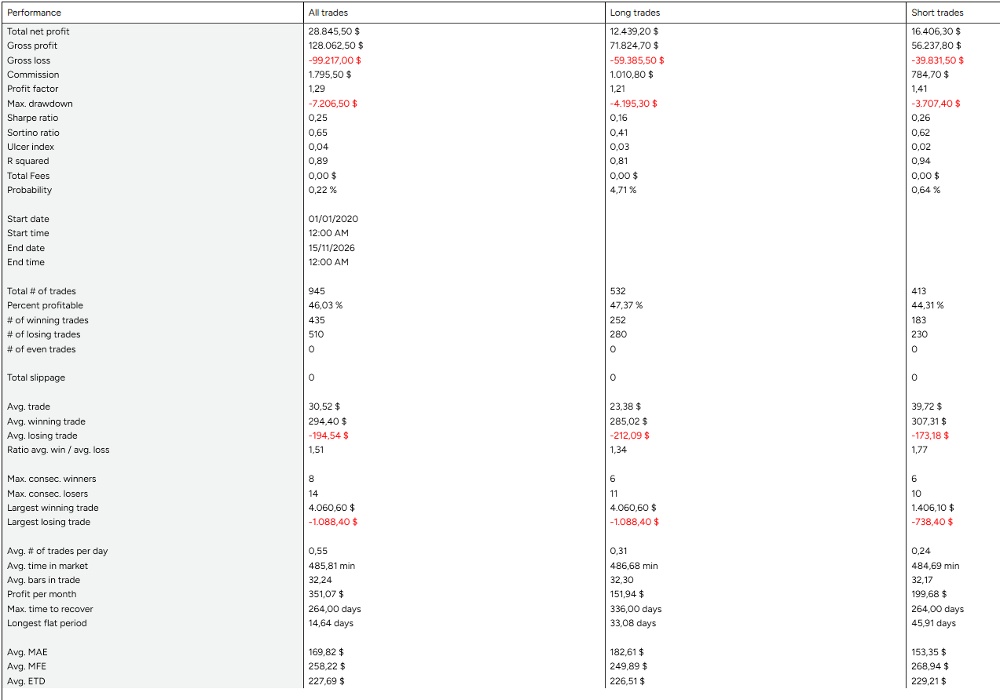
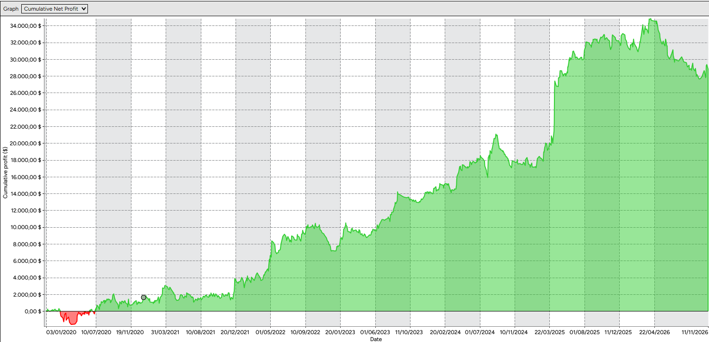
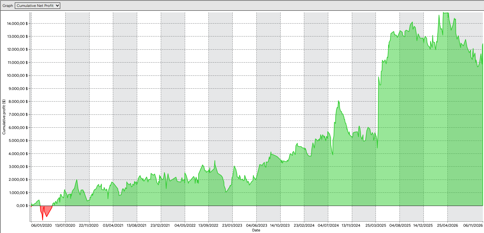
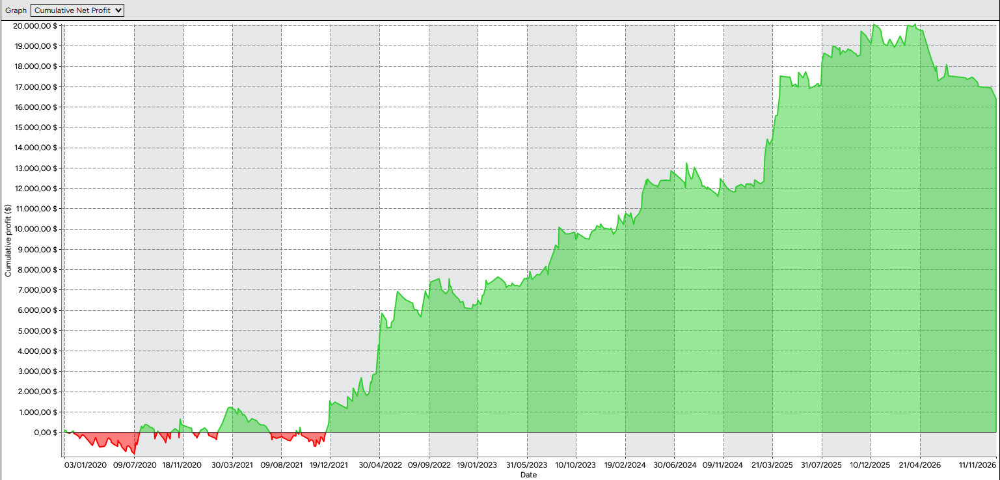

# GenStrat_MNQ_ADX_EMACross_G4_I47

A NinjaTrader 8 automated trading strategy for **MNQ** (Micro E-mini Nasdaq-100) on the **15-minute (15M)** timeframe, combining **ADX trend strength** with an **EMA crossover** and an **ATR-based stop loss**.

---

## How It Was Created

This strategy was automatically synthesized using **Genetic Strategy Lab**, a genetic-algorithm strategy generation and evaluation engine.

### Synthesis Summary (Training Run)

| Metric | Value |
| --- | --- |
| **Instrument** | MNQ |
| **Timeframe** | 15 Minutes (15M) |
| **Training Period** | `2026-09-16` to `2026-11-15` |
| **Synthesized Rules** | ADX Trend Strength (14) + EMA Crossover (9 / 21) |
| **Trades Generated** | 103 (MinTrades filter: 100) |
| **Profit Factor** | 2.23 |
| **Net Profit** | $4,635 |
| **Win Rate** | 56.3% |
| **Max Drawdown** | $819 |

> **Note:** These figures come from the original in-sample training synthesis and are not a guarantee of future performance.

### Strategy Analyzer Screenshots

#### Performance Summary


#### All Trades


#### Long Trades


#### Short Trades


---

## How It Works

The strategy evaluates rules on bar close (`Calculate.OnBarClose`) once at least 30 bars are loaded (`CurrentBar >= 30`).

### Indicators Used
- **ADX(14)** — Trend strength filter (plotted on chart)
- **EMA(9)** & **EMA(21)** — Fast and slow exponential moving averages (plotted on chart)
- **ATR(14)** — Volatility measure used to size the stop loss

### Entry Rules (when flat)
- **Long Entry:**
  1. `ADX(14)[0] > 25`
  2. Bullish candle (`Close[0] > Open[0]`)
  3. `EMA(9)` crosses above `EMA(21)` (`CrossAbove(emaFast, emaSlow, 1)`)
- **Short Entry:**
  1. `ADX(14)[0] > 25`
  2. Bearish candle (`Close[0] < Open[0]`)
  3. `EMA(9)` crosses below `EMA(21)` (`CrossBelow(emaFast, emaSlow, 1)`)

### Exit Rules & Configurable Parameters
- **`StopLossATRMult`** (default: `5.0`, range: `0.0–20.0`): Places a stop loss at `ATR(14) * StopLossATRMult` converted to ticks (minimum 1 tick). Set to `0` to disable the ATR stop loss.
- **Session Close:** `IsExitOnSessionCloseStrategy = true` (closes open positions 30 seconds before session close).

---

## Installation (NinjaTrader 8)

1. Download or clone this repository.
2. Copy `GenStrat_MNQ_ADX_EMACross_G4_I47.cs` into your NinjaTrader 8 Strategies folder:
   ```text
   Documents\NinjaTrader 8\bin\Custom\Strategies\
   ```
3. Open **NinjaTrader 8**.
4. Go to **New → NinjaScript Editor** and press **F5** (or click **Compile**) to compile the script.
5. Once compiled with no errors, the strategy `GenStrat_MNQ_ADX_EMACross_G4_I47` will be available in **Strategy Analyzer** and on charts (designed for **MNQ** on a **15-minute / 15M** chart).

---

## Disclaimer

This software and its source code are provided **for educational and research purposes only** and do **not** constitute financial, investment, or trading advice.

Trading futures and other financial instruments involves substantial risk of loss and is not suitable for every investor. Past or backtested performance is not indicative of future results. **Any use of this strategy—whether in simulation, backtesting, or live trading—is strictly at the end user's own risk and responsibility.** The author assumes no liability for any financial losses or damages resulting from the use of this code.
